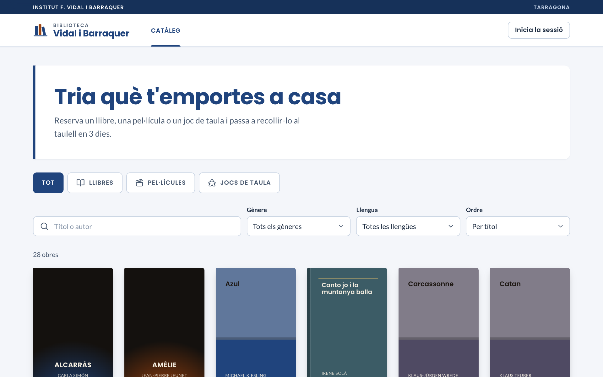
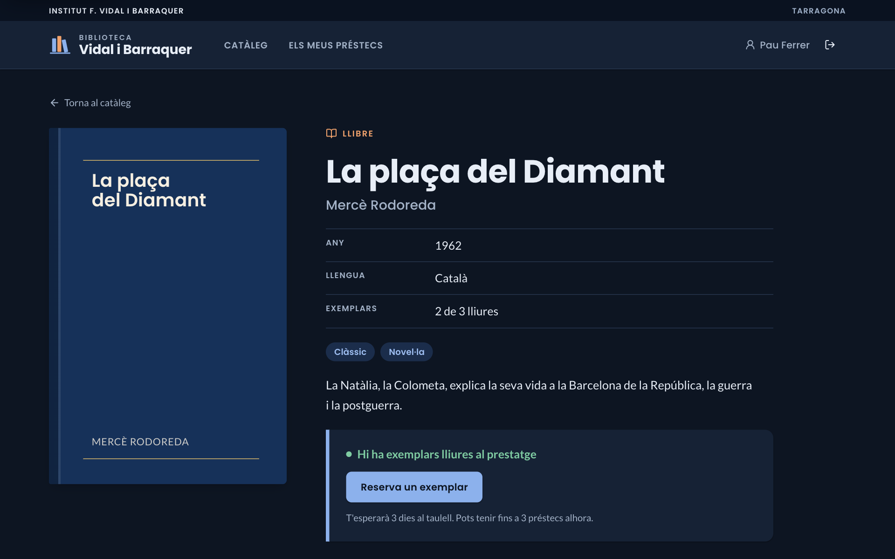
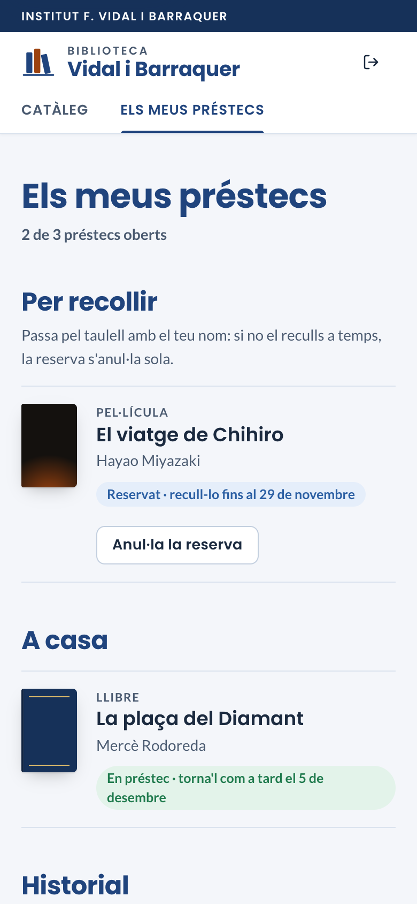
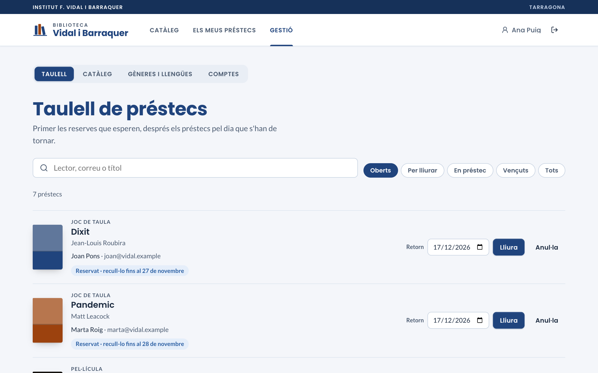

<div align="center">

# Biblioteca Vidal i Barraquer

**The catalog and the loans of a school library: books, films and board games, reserved online and picked up at the desk.**

[](https://github.com/davidcastillocruz/VidalLibrary/actions/workflows/ci.yml)
[](LICENSE)




[Overview](#overview) · [Features](#features) · [Quick start](#quick-start) · [How the library works](#how-the-library-works) · [Project structure](#project-structure) · [Testing](#testing) · [License](#license)

</div>

---

## Overview

Anyone can browse the catalog. Readers with an account reserve a copy of a work, pick it up at the desk within three days and bring it back by the day the librarian sets. Librarians run everything from the management panel: the loan desk, the catalog and its covers, the genres and languages, and the accounts.

There is no sign-up. A librarian creates each account and the owner gets an email to choose a password. Reminders go out by email before a loan is due and when it is late, and reservations nobody picks up are cancelled on their own.

The interface is in Catalan, Spanish and English, with a light and a dark theme, and takes the colors and the type of [the institute's website](https://www.vidalibarraquer.cat/). It is built on [FastAPI-React-Template](https://github.com/davidcastillocruz/FastAPI-React-Template) and follows its architecture and rules.

<table>
  <tr>
    <td width="68%"></td>
    <td width="32%"></td>
  </tr>
</table>

## Features

### For readers

- **Catalog**: tabs by kind, search by title or author, filters by genre and language, three orders. Everything lives in the address, so a search can be shared and the back button works.
- **A page per work**: its card, its genres, its synopsis and how many copies are free right now.
- **Reservations**: one press reserves a copy; the reader's loans page shows what to pick up, what is at home and the history, and a reservation can be cancelled.
- **Emails**: an invitation to choose a password, password recovery, and warnings two days before a loan is due and when it is late.

### For librarians

- **Loan desk**: the reservations waiting first, then the loans by due day. Hand one over with its due day, receive it back or cancel it, and search by reader or title.
- **Catalog**: add and edit works, their genres and copies, upload a cover (PNG, JPEG or WebP, kept as WebP) or let the app draw one from the title.
- **Genres and languages**: the filters of the catalog, renamed or deleted in place.
- **Accounts**: create readers and librarians with an invitation email, send it again, change names and roles, delete accounts without open loans. The library always keeps at least one librarian, even when two of them change each other at once.

### Under the hood

- **One catalog** for the three kinds of work: a single `items` table with a `kind`, instead of three copies of the same module.
- **No double booking**: a reservation locks the reader and then the work, so neither the limit of three loans nor the copies of a work can be passed by two requests at once. A partial unique index keeps one open loan of a work per reader.
- **A background job** cancels expired reservations and sends each warning once, claiming the loans with `SKIP LOCKED` so several processes never repeat one.
- **Sessions** in an HTTP-only cookie, stored as a hash. Passwords with Argon2. Failed sign-ins limited per email, every route rate limited per IP or per user.
- **Covers** are shrunk before anything else, so a photo from a phone never fills the memory, and saved under a new version on every change: the browser keeps each version for good, so a page of the catalog doesn't download its covers again.
- **Tests**: 300+ backend tests against a real PostgreSQL, concurrency included, and frontend tests with Vitest and Testing Library.



## Tech stack

| Layer | Tools |
| --- | --- |
| Backend | Python 3.14, FastAPI, Pydantic, SQLAlchemy 2 (async), Alembic, Argon2, Pillow, slowapi, fastapi-mail |
| Frontend | React 19, Vite 8, React Router, axios, CSS modules, Poppins and Lato, oxlint |
| Services | PostgreSQL 17, Redis 8, Mailpit |
| Testing | pytest, httpx · Vitest, jsdom, Testing Library |
| Tooling | Docker Compose, GitHub Actions, ruff, pyright |

## Quick start

**Requirements:** [Docker](https://www.docker.com/) with Docker Compose. Everything, tests included, runs inside the containers.

```bash
git clone https://github.com/davidcastillocruz/VidalLibrary.git
cd VidalLibrary
```

There are no env files in the repository. Create the two of them with the values for Docker (git ignores them):

```bash
cat > backend/.env.api <<'EOF'
APP_TITLE=Vidal Library
APP_DESCRIPTION=The catalog and the loans of the Vidal i Barraquer library
APP_MODE=development
DATABASE_HOST=db
DATABASE_PORT=5432
DATABASE_POOL_SIZE=5
DATABASE_MAX_OVERFLOW=10
RATE_LIMIT_STORAGE_URI=redis://redis:6379
CORS_ORIGINS=http://localhost:5173
FRONTEND_URL=http://localhost:5173
MAIN_LANGUAGE=ca
AVAILABLE_LANGUAGES=ca,es,en
MAIL_USERNAME=biblioteca@vidal.example
MAIL_PASSWORD=password
MAIL_FROM=biblioteca@vidal.example
MAIL_SERVER=mailpit
MAIL_PORT=1025
MAIL_START_TLS=false
MAIL_SSL_TLS=false
SESSION_COOKIE_NAME=session
SESSION_COOKIE_SECURE=false
EOF

cat > backend/.env.db <<'EOF'
POSTGRES_USER=postgres
POSTGRES_PASSWORD=1234
POSTGRES_DB=app
EOF
```

Start everything, then fill the empty library with the demo data:

```bash
docker compose up --build -d
docker compose exec backend python -m src.commands.seed_demo
```

| Service | URL |
| --- | --- |
| Web | http://localhost:5173 |
| API docs (Swagger) | http://localhost:8000/docs |
| Mailpit (every email the app sends) | http://localhost:8025 |

The demo data brings 28 works, loans in every status and two accounts, both with the password `vidal-demo-2026`:

| Account | Role |
| --- | --- |
| `biblioteca@vidal.example` | Librarian: sees the management panel |
| `lector@vidal.example` | Reader: has a reservation, a loan and some history |

To start a real library instead, create its first librarian; the invitation arrives at Mailpit:

```bash
docker compose exec backend python -m src.commands.create_librarian ana@example.org "Ana Puig"
```

## How the library works

The rules live in one place, [`backend/src/modules/loan/loan_rules.py`](backend/src/modules/loan/loan_rules.py):

| Rule | Value |
| --- | --- |
| Open loans per reader (reserved or picked up) | 3 |
| Open loans of the same work per reader | 1 |
| Time to pick up a reservation | 3 days, then it is cancelled |
| Warning before the due day | 2 days |
| Longest loan | 90 days |
| Copies of a work | 1 to 100, never fewer than its open loans |

A loan goes `requested` → `active` → `returned`, or `requested` → `cancelled` (by its reader, by a librarian or by the job). Days are the ones of the library, in Barcelona, wherever the server runs.

## Project structure

```
.
├── backend/
│   ├── src/
│   │   ├── main.py                  # app, middlewares, routers and the loan job
│   │   ├── api/                     # dependencies (session, roles) and one router per area
│   │   ├── modules/
│   │   │   ├── auth/                # sessions, sign-in, invitations and password recovery
│   │   │   ├── user/                # accounts and their management
│   │   │   ├── catalog/             # works, genres, languages and covers
│   │   │   └── loan/                # reservations, the desk, the rules and the job
│   │   ├── commands/                # create_librarian, seed_demo
│   │   ├── mail/                    # the layout and the texts of every email
│   │   ├── security/                # tokens, passwords, cookies
│   │   └── storage/                 # the files of the covers
│   ├── alembic/versions/            # one migration per feature
│   └── tests/
├── frontend/src/
│   ├── features/
│   │   ├── catalog/                 # the catalog and the page of a work
│   │   ├── loans/                   # my loans
│   │   ├── auth/                    # sign-in, recovery, invitation, current user
│   │   └── admin/                   # desk, catalog, genres and languages, accounts
│   ├── components/                  # header, footer, cover, buttons, fields...
│   ├── themes/  languages/          # light and dark, ca, es and en
│   └── notifications/               # the toasts
├── docs/                            # the screenshots of this README
├── CLAUDE.md                        # how to work on the code
└── docker-compose.yml
```

## Testing

```bash
docker compose exec backend pytest            # backend, against its own test database
docker compose exec backend ruff check        # lint
docker compose exec backend pyright           # types
docker compose exec frontend npm test         # frontend
docker compose exec frontend npm run lint
```

GitHub Actions runs the same on every push, plus `alembic check` (a model changed without its migration fails) and the production build of the frontend.

## Working on it

[`CLAUDE.md`](CLAUDE.md) holds the conventions of every layer and the decisions of this project; the guides of the backend and the frontend (adding a module, a page, a translation) are the ones of [the template](https://github.com/davidcastillocruz/FastAPI-React-Template#backend-guide).

## License

[MIT](LICENSE): use it, change it and share it, keeping the copyright notice.

---

<div align="center">

Made by [@davidcastillocruz](https://github.com/davidcastillocruz)

</div>
